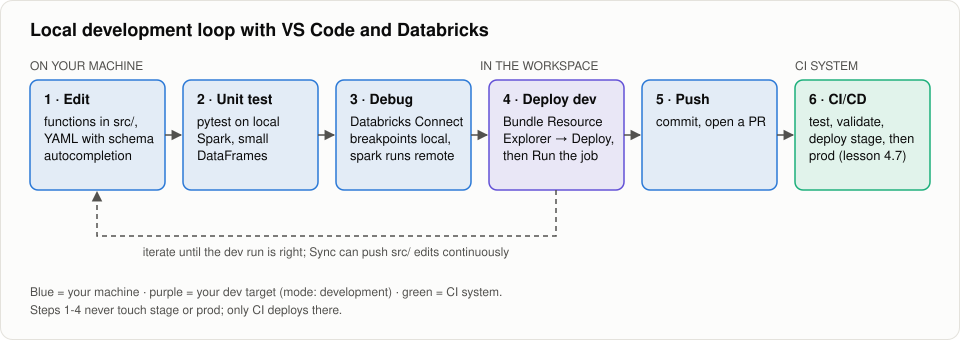

# 4.9 Using VS Code with Databricks
**Lessons:** Developing Locally with Visual Studio Code · Demo: Using VS Code with Databricks

## 1. Install
- VS Code extension **Databricks** (publisher: Databricks). It bundles the CLI and adds a *Databricks* side bar.
- Optional: the **YAML** extension (Red Hat). With the bundle JSON schema it gives autocompletion and validation in `databricks.yml`:
  ```powershell
  databricks bundle schema > .vscode/bundle_config_schema.json
  ```
  ```json
  // .vscode/settings.json
  { "yaml.schemas": { ".vscode/bundle_config_schema.json": ["databricks.yml", "resources/*.yml"] } }
  ```

## 2. Connect
1. Open a bundle folder, e.g. `04-automated-deployment-dabs/bundles/02_multi_env_dab`.
2. *Databricks* side bar → **Configure** → pick your CLI profile (from `databricks auth login`) or log in with OAuth.
3. The extension reads `databricks.yml`. Choose the **target** (dev/stage) in the side bar.

## 3. Develop
| Action | How |
|---|---|
| Deploy the bundle | *Bundle Resource Explorer* → **Deploy** (same as `databricks bundle deploy -t <target>`) |
| Run a job or pipeline | hover the resource → **Run** (same as `bundle run`) |
| Sync files while editing | *Sync* → on (pushes `src/` changes to the workspace folder of the target) |
| Run a Python file on serverless or a cluster | right-click → *Run on Databricks* → *Upload and Run File* |
| Debug locally against remote compute | **Databricks Connect**: `pip install databricks-connect`, select *Databricks Connect* as the interpreter feature, set breakpoints. `spark` executes remotely |
| Unit tests | Testing side bar → pytest (local Spark as in `bundles/03_cicd_dab/tests`, or Databricks Connect) |

## 4. Recommended loop


**How to read it:** steps 1-3 (blue) run on your machine; only step 3 reaches the workspace, through Databricks Connect.
Step 4 deploys your own dev target from the Bundle Resource Explorer, and the dashed arrow is the inner loop you repeat.
Once you push (step 5), CI from lesson 4.7 takes over and is the only path to stage and prod.

1. Write logic as functions in `src/` and test them locally with pytest.
2. Use Databricks Connect for code that needs real data or Unity Catalog.
3. Deploy to your **dev** target from VS Code and run the job.
4. Commit and push. CI (lesson 4.7) validates, tests, and deploys to stage and prod.
